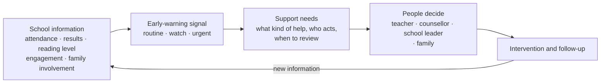

# How EduSight works

EduSight turns everyday school information into one question a teacher can act on: *who needs help, what kind, and from whom?*

## The information EduSight uses

EduSight works with the information most schools already record. More information gives a more confident signal, but none of it is mandatory. When something important is missing, EduSight says so and suggests what to collect next.

| Information | Examples |
| --- | --- |
| Attendance | attendance percentage this term, consecutive days absent |
| Learning | scores in **any subject the school assesses** (mathematics, reading and writing, plus science, languages, humanities, arts and so on), converted to 0–100; reading or literacy level |
| Engagement | a teacher's 1–5 engagement rating, or the number of behaviour incidents |
| Home | homework completion, guardian engagement |
| Interests | extracurricular activities: sports, music, clubs, leadership roles and others |
| Context | grade, age, school type |

Sensitive information is handled carefully. This includes health, disability, ethnicity, religion, income, refugee status and pregnancy. EduSight does not ask for it in order to produce a signal. See [Responsible use](responsible-use.md).

## A full picture of each learner

A learner is more than three test scores. For every learner EduSight builds a profile from everything recorded about them:

- **Every subject, against their own history.** Each subject shows the latest score, the learner's own average before it, and the change. A drop from 75 to 62 matters even though 62 is a pass. A rise from 40 to 55 is real progress even though 55 is modest. The overall average and attendance are tracked the same way, so a temporary dip can be told apart from a pattern.
- **Strengths, and how to keep them.** Subjects where the learner scores 70% or more, or has clearly improved, are listed with concrete ways to sustain them. Examples are extension tasks, peer teaching, and clubs or competitions. Strong learners need attention too.
- **Growth areas, and how to improve them.** Subjects below 50%, or clearly below the learner's own record, come with practical next steps for that subject. For example: "find the specific gap first, then ten minutes of daily practice".
- **Interests and activities.** Football, choir, chess, debate, leadership roles and other activities are recorded by the school or the family. For each one EduSight shows what it can build, such as teamwork, concentration or confidence speaking. Where an activity connects to a subject the learner is working on, EduSight suggests using the activity as a way in. Learners often work harder on problems tied to something they care about. These are suggestions about what an activity *can* support, not promises.

Strengths and growth areas describe recorded scores, not ability.

## The early-warning signal

Each time new information arrives, EduSight gives the learner a **support level**:

| Support level | Meaning | What usually happens |
| --- | --- | --- |
| **Routine** | On track. | Keep teaching and keep observing. |
| **Watch** | Early signs of difficulty. | Plan a light-touch response and check again soon. |
| **Urgent** | Clear signs that the learner needs help now. | Someone at the school reviews this learner this week. |

The signal takes every assessed subject into account, not only mathematics, reading and writing. It also compares the latest results with the learner's previous assessment. Every signal says *why*. It lists the main drivers, such as "attendance below target" or "foundational literacy support needed", and how confident EduSight is given the data it had. A signal is a prompt to look closer. It is never a verdict about the learner.

## Support needs: the kind of help

The support level says how soon to act. **Support needs** say what to do. One learner can have several.

| Support need | When EduSight suggests it | Who usually acts |
| --- | --- | --- |
| **Attendance follow-up** | Attendance below target, or several days missed in a row | Class teacher with the family |
| **Foundational literacy support** | Reading level too low to learn comfortably in other subjects | Teacher |
| **Academic catch-up** | Scores below 50% in one or more subjects | Teacher |
| **Wellbeing check-in** | Low classroom engagement, or a sharp drop in results | Counsellor or pastoral lead |
| **Learning-needs screening** | The learner attends regularly but still struggles with core skills | Special-needs coordinator or educational assessor |
| **Family partnership** | Low home-engagement indicators | Teacher with the family |

Each need comes with a concrete next step and a review date.

### About learning-needs screening

Some learners come to school every day and still struggle. Catch-up lessons alone may not be enough for them. The cause can be a learning difficulty, or a vision or hearing problem, or something else entirely. EduSight cannot tell which, and it does not try. When it sees this pattern, it suggests that a qualified person consider a screening, and it marks the case for human review. **This is not a diagnosis**, and it is never shown to the learner or family as one.

## Human review

EduSight marks a learner for human review in two cases:

- the support level is **urgent**, or
- a **referral** is suggested, such as a learning-needs screening or a counsellor for a serious wellbeing concern.

Partner systems receive this as `needs_human_review` and should route the learner to a named person rather than act automatically.

## What EduSight will not do

- It will not label learners as "failures", "likely dropouts" or similar.
- It will not recommend exclusion, punishment, streaming or ranking.
- It will not show risk scores to learners or families. Wording meant for families is supportive and never includes probabilities.
- It will not make a decision about a learner on its own.
