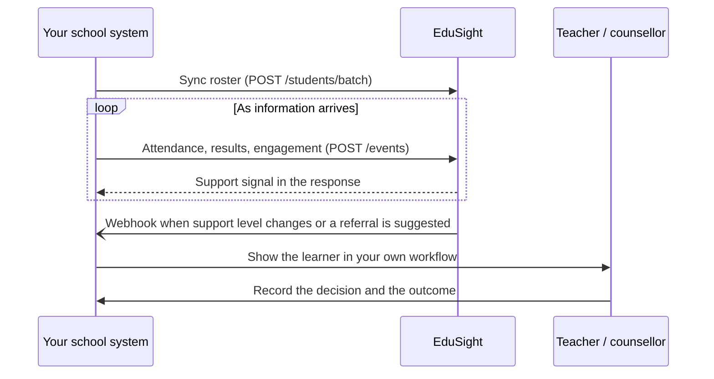

# Connect your system

EduSight is designed to plug into the system a school already runs, whether that is a school management system, a student information system, a learning platform or a ministry data service. Your system remains the source of truth for learners. EduSight adds early-warning signals and support guidance on top.

## How the pieces fit



There are four building blocks. Use the ones that fit your product.

| Building block | Use it to… | Endpoint |
| --- | --- | --- |
| **Roster sync** | keep EduSight's learner list matched to yours, up to 500 learners per call | `POST /api/v1/integrations/students/batch` |
| **Events** | send attendance, assessment or engagement updates as they happen, safe to retry | `POST /api/v1/integrations/events` |
| **Support signals** | read the latest signal and recommendations for a learner | `GET /api/v1/integrations/students/{id}/risk` and `/recommendations` |
| **Webhooks** | be told when something changes, without polling | `POST /api/v1/integrations/webhooks` |

If you only need a one-off score and EduSight should keep nothing, use **stateless prediction**: `POST /api/v1/integrations/predict`.

## Quick start

### 1. Get an API key

An EduSight administrator issues your organisation an API key. The key is shown **once**; store it in your secrets manager. Every request carries it in a header:

```http
X-API-Key: esa_your_partner_key
```

A key can be limited to a single school. Keys issued by a school administrator are always limited to that school. A key only ever sees the learners its organisation registered, or the learners in the school it is bound to. Other partners' learners return `404`.

### 2. Sync your roster

Use **your own learner IDs** as `external_student_id`. EduSight maps them to its internal IDs, so you never need to store EduSight IDs if you prefer not to.

```http
POST /api/v1/integrations/students/batch
Content-Type: application/json
X-API-Key: esa_your_partner_key

{
  "students": [
    { "external_student_id": "sis-1042", "full_name": "Amina Otieno", "grade_level": 6, "age": 12 },
    { "external_student_id": "sis-1043", "full_name": "Baraka Mwangi", "grade_level": 6, "age": 11 }
  ]
}
```

Running the same sync again updates existing learners rather than duplicating them. The response reports `created`, `updated` and `failed`, with a per-learner result, so one bad record does not block the rest.

### 3. Send events as they happen

```http
POST /api/v1/integrations/events
X-API-Key: esa_your_partner_key

{
  "event_id": "attendance-2026-T3-W8-sis-1042",
  "event_type": "attendance",
  "external_student_id": "sis-1042",
  "occurred_at": "2026-10-24T15:00:00Z",
  "payload": { "attendance_rate": 0.68, "recent_absence_streak": 4 }
}
```

- **`event_id` makes retries safe.** If your system sends the same `event_id` twice, the second is acknowledged with `"duplicate": true` and changes nothing. Use an ID that is stable for that piece of information.
- Supported `event_type` values that produce a signal: `attendance`, `assessment`, `behavior`, `assignment`, `lms.activity`. Other types are accepted and acknowledged but do not change the signal.
- The response contains the new support signal, so you can show it immediately.

### 4. Subscribe to webhooks

```http
POST /api/v1/integrations/webhooks
X-API-Key: esa_your_partner_key

{ "url": "https://sis.example.org/hooks/edusight" }
```

The response includes a signing `secret`, shown once. From then on EduSight posts to your URL when a learner's support level changes or a referral is suggested. See [Webhooks](webhooks.md).

### 5. Show the signal in your workflow

What to show, and to whom:

| Field | Show to | Notes |
| --- | --- | --- |
| `support_level` (`routine` / `watch` / `urgent`) | teachers, school leaders | Prefer this over `risk_level` in your UI. |
| `support_needs[]` | teachers, counsellors | Each item has `title`, `next_step`, `owner`, `review_in_days` and `referral_suggested`. |
| `needs_human_review` | the person responsible | When `true`, route the learner to a named person. Do not automate the response. |
| `risk_drivers[]` | teachers | The plain-language reasons. |
| `parent_explanation` | parents and guardians | Show only teacher-approved guidance to families. |
| `risk_probability`, `risk_level` | analysts only | Do not show these to learners or families. |
| `model_version` | your audit log | Store it with every action taken. |

## Mapping your data

EduSight accepts several common field names, so you can often send what you already have:

| EduSight field | Also accepted | Range |
| --- | --- | --- |
| `external_student_id` | `student_external_id`, `learner_id` | your ID, up to 120 characters |
| `attendance_pct` | — | 0–100, always a percentage |
| — | `attendance_rate`, `attendance_percentage` | 0–1 fraction or 0–100 percentage; a value of 1 or less is read as a fraction |
| `math_score` | `numeracy_score` | 0–100 |
| `reading_score` | `literacy_score` | 0–100 |
| `writing_score` | — | 0–100 |
| `subject_scores` | — | any other subjects, e.g. `{"science": 64, "kiswahili": 71}`; names are normalised, 0–100 each, up to 30 |
| — | `academic_average` | 0–100, used for all three subjects when they are not sent individually |
| `score_trend` | derived from `academic_average` and `previous_term_average` | −1 to 1 |
| `behavior_rating` | derived from `behavior_incidents` (0 incidents = 5) | 1–5 |
| `literacy_level` | — | 1–10 |
| `home_engagement_composite` | derived from `guardian_engagement_score` and `assignment_completion_rate` | 0–1 |
| `recent_absence_streak` | — | consecutive days absent |

Convert grades on any scale to a 0–100 percentage before sending: A–E letters, CBC rubric levels, points, and so on.

## SDKs

Lightweight clients for **TypeScript** and **Python** are available to integration partners; ask Uzi Org for access. Both cover roster sync, events, assessments, signals, recommendations and webhook registration. They also include `verifyWebhookSignature` / `verify_webhook_signature` for checking incoming webhooks.

```python
from edusight_africa import EduSightClient

client = EduSightClient("https://edusight.example.org", api_key="esa_…")
client.sync_students([{"external_student_id": "sis-1042", "full_name": "Amina Otieno", "grade_level": 6, "age": 12}])
client.ingest_event({"event_id": "att-1042-w8", "event_type": "attendance", "external_student_id": "sis-1042",
                     "payload": {"attendance_rate": 0.68}})
```

## Next

- [API reference](api-reference.md)
- [Webhooks](webhooks.md)
- [Responsible use](../responsible-use.md): obligations for partners
